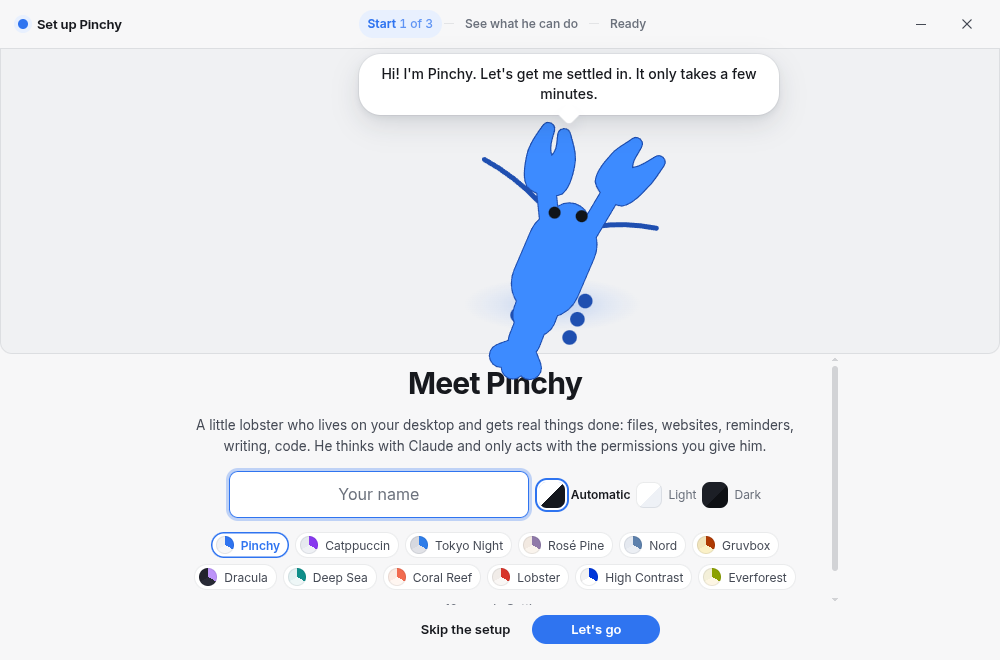
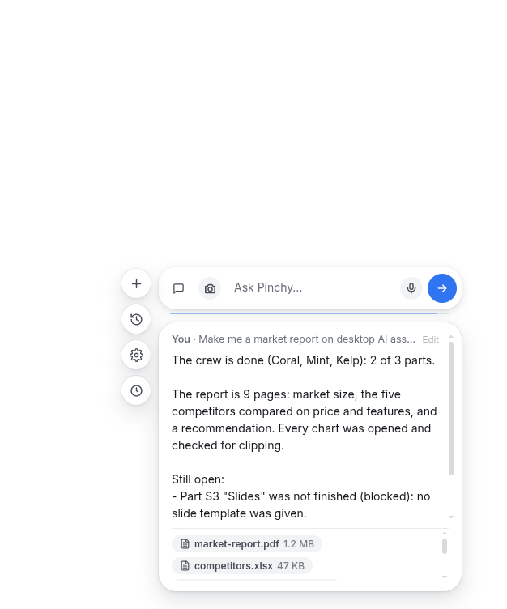
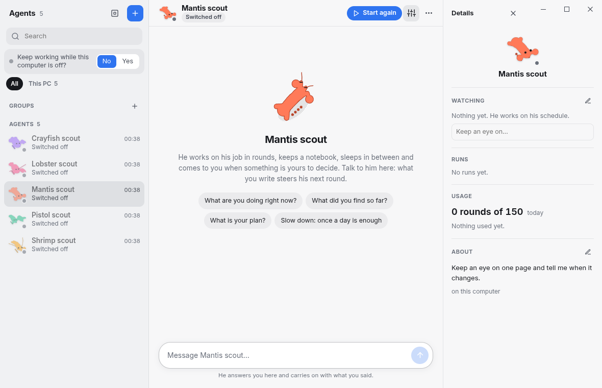
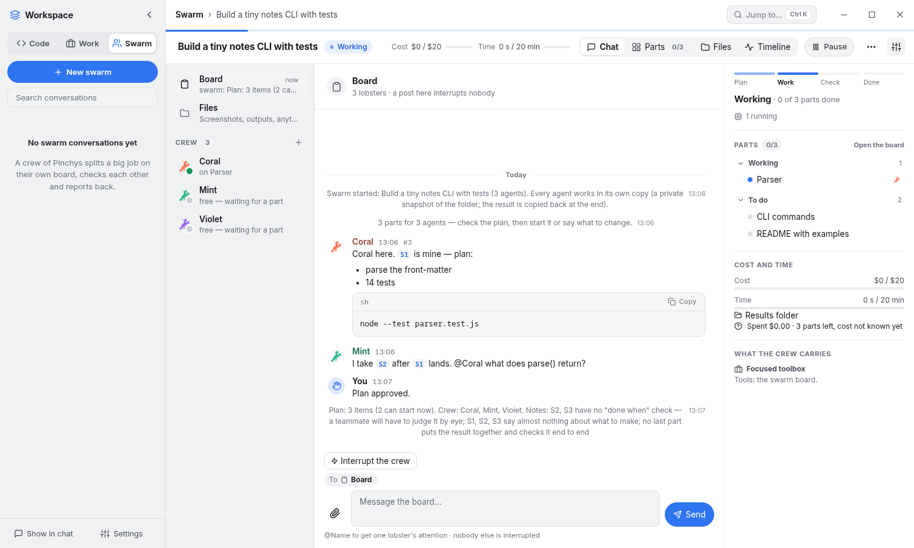
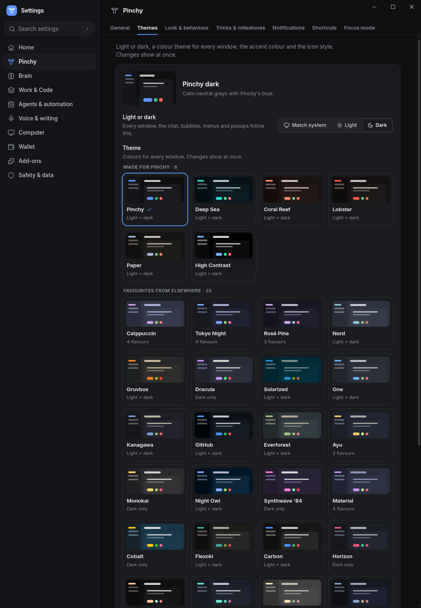
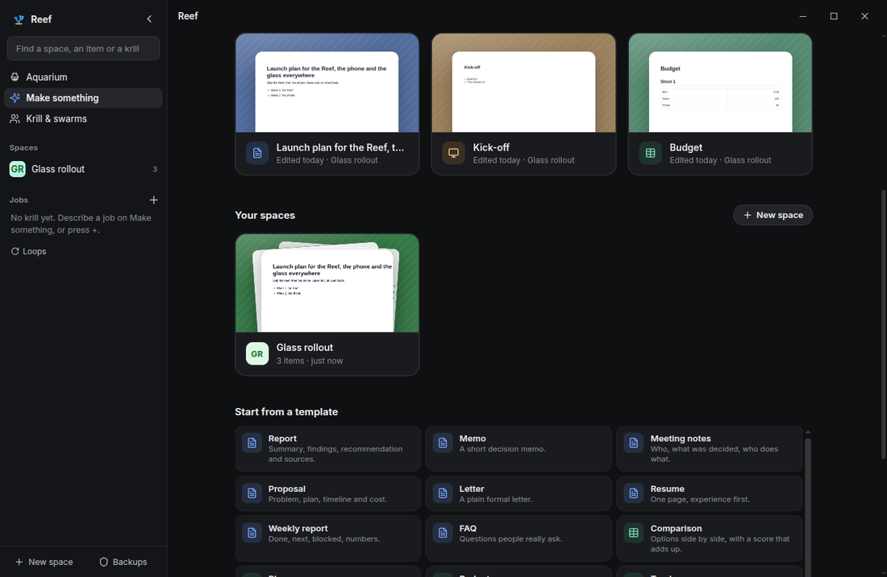
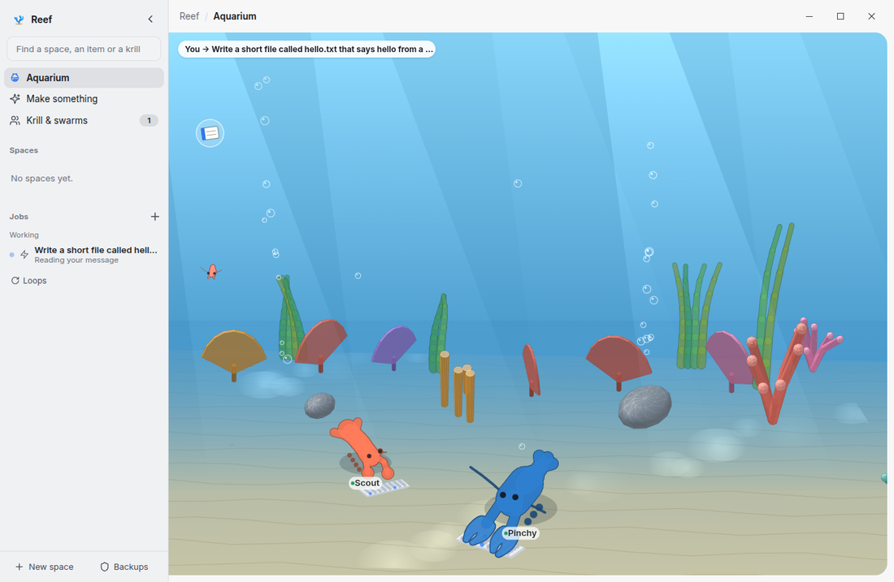
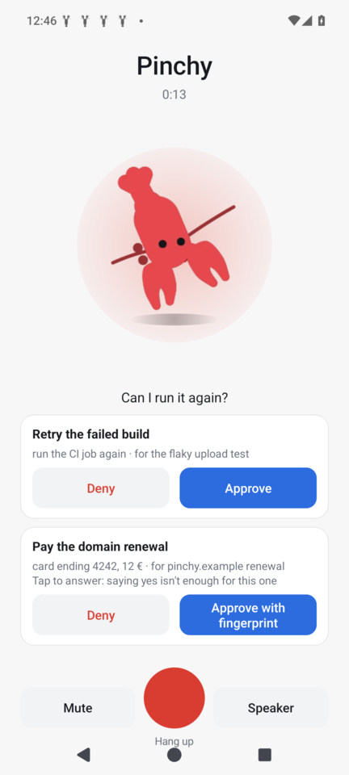

  

<h1 align="center">Pinchy — the desktop assistant that lives on your screen</h1>

  A small blue lobster for Windows, macOS and Linux that does real work on your computer. 
  He is a full <b>agent harness that runs on the AI you choose</b>: Claude Code, another CLI, any API key or a model on your own machine. 
  Chat, files, computer use, agents, krill, swarms, the Reef, a video editor, calls, a real browser, a Vault, a phone app, an away server 
  and the Lobster Network — all working together, with a face.

<!-- downloads:buttons -->

  
  
  
  

Version 2.9.3 · Intel Mac and the portable Windows build are in the table below · <a href="https://github.com/casualkre/pinchy-releases/releases/latest">all files and release notes</a>

<!-- /downloads:buttons -->

  
  
  

**Jump to:** [Download](#download) · [What Pinchy can do](#what-pinchy-can-do) · [Screenshots](#screenshots) · [What you need](#what-you-need) · [Safety](#safety-and-privacy) · [What's new](#whats-new) · [FAQ](#faq) · [Facts for AI agents](#facts-for-ai-agents-and-search)

---

## Download

<!-- downloads:table -->
| Your device | File | Size | Then |
|---|---|---|---|
| **Windows 10/11** | [BlueLobster-Setup-2.9.3.exe](https://github.com/casualkre/pinchy-releases/releases/download/v2.9.3/BlueLobster-Setup-2.9.3.exe) | 120 MB | Run it. SmartScreen asks once (the build is not code-signed). |
| **Windows, no install** | [BlueLobster-Portable-2.9.3.exe](https://github.com/casualkre/pinchy-releases/releases/download/v2.9.3/BlueLobster-Portable-2.9.3.exe) | 120 MB | Run it from any folder. |
| **macOS (Apple silicon)** | [BlueLobster-2.9.3-mac-arm64.zip](https://github.com/casualkre/pinchy-releases/releases/download/v2.9.3/BlueLobster-2.9.3-mac-arm64.zip) | 137 MB | Unzip, move to Applications, right-click → Open the first time. |
| **macOS (Intel)** | [BlueLobster-2.9.3-mac-x64.zip](https://github.com/casualkre/pinchy-releases/releases/download/v2.9.3/BlueLobster-2.9.3-mac-x64.zip) | 141 MB | Same. |
| **Linux x86_64** | [BlueLobster-2.9.3.AppImage](https://github.com/casualkre/pinchy-releases/releases/download/v2.9.3/BlueLobster-2.9.3.AppImage) | 135 MB | `chmod +x` it and start it. |
| **Android phone or tablet** | [Pinchy-Android.apk](https://github.com/casualkre/pinchy-releases/releases/download/v2.9.3/Pinchy-Android.apk) | 10 MB | Install, then pair with your computer by QR code. |
<!-- /downloads:table -->

You install once. After that **Pinchy updates himself**: he tells you when a new version is out and you press *Update now*.

## What Pinchy can do

- **Chat that gets things done.** Double-click him and ask: read and change files, run commands, search the web, fix a failing test. He asks before anything risky (*Allow once / Always / Deny*) and keeps an undo timeline.
- **Runs on the AI you choose.** Claude Code, other command line agents, an API key from any of 20 listed providers, any OpenAI-style or Anthropic-style address, or a local model through Ollama, LM Studio, llama.cpp and others. Pinchy has his own engine for API keys and local models, with the same chat, approvals and undo, and one model picker everywhere with search, grouping and favourites, so hundreds of OpenRouter models stay findable. Every engine gets the same Pinchy tools through one door, so a krill on Cursor, Codex or a local model can do what one on Claude Code can. Delegation profiles let cheap models do the easy parts and strong ones the hard parts, with fallbacks when a plan runs out (said once, and once when it's back), monthly caps per provider, and limits per model. A small **decision model** on your own computer answers quick yes/no questions in a tenth of a second for free. **NO GROK.**
- **Use the computer for you.** He looks at the screen, clicks and types, reads a desktop app's buttons and text by name instead of guessing from a screenshot, and waits until a page has really finished loading. On Linux (KDE Plasma 6) he can work on **his own hidden desk**, so your mouse and keyboard stay yours and file changes wait for your *Keep*.
- **Agents that work like a coworker.** Give one a schedule ("every weekday at 9"), a trigger (a web page or price changes, a new release, a file, an email) or a standing goal. It works on its own, parks risky steps for your yes, checks its own result for real defects before it hands it over, and can start helpers or a whole crew for a big job. You hear from it when the work is done or when it needs you — on your phone, in a chat app or by email. Every agent can be one of five creatures — lobster, shrimp, crayfish, pistol shrimp or mantis shrimp — each with its own body and strength.
- **Krill.** One job, done and gone: press New krill, pick a type, and it uses every tool Pinchy has, here or on your away server, then hands back the result. Code krill work on their own branch with checks, an independent review and one-click apply. There are code review and research krill, and you can write your own loops. Pinchy, your agents, your computer and your phone can all start them, and a krill can hand parts of its job to its own sub-krill. A krill has to prove "done": Pinchy checks that its change really happened. Krill, agents and Pinchy write to each other and get answers back.
- **Swarms.** A swarm of krill takes on one big job together: a shared board folder, a board chat and private messages between them, each part checked by someone who didn't make it, with a cost cap. You watch them as coloured lobsters, and in the Reef's aquarium.
- **The Reef.** One window for what you and your agents make and for the krill making it, with an **aquarium** where Pinchy, every agent and every krill swim as their own 3D creatures and pass notes. Documents, slides with animations, transitions and morph, sheets, charts, drawings, web pages, whole code projects with a real terminal, **CAD** (3D parts for your printer, circuit boards with fab files for PCBWay), and a **video editor**: cut your own clips, add titles, real 3D, fake app windows for product demos, music that ducks under a voice. Cards show what's inside. Agents and krill hand their reports over as documents here (the same report updates the same document), you can @mention an agent in a document, and a document can keep itself up to date. Every item has its own krill beside it: talk to it, watch its changes light up in place, and pick its model right there. Agents look at what they made as pictures and fix what's broken before they hand it over. Everything is editable by hand, with comments on the exact place you mean and exports to PDF, Word, Excel, PowerPoint, images and video. A spelling fixer works quietly in every text. **What happened** shows everything Pinchy, agents, krill and you changed, with an Undo on each step.
- **The Vault.** Logins, cards and API keys in a separate locked process with its own passphrase. Pinchy and his agents only ever hold a handle like `vault:hetzner`, never the value. You approve each use, and the card says what it is, what it's for and every site it goes to; a site it wasn't saved for needs your passphrase. Pinchy and his agents can add logins too (with a password nobody ever sees), and the page can't be read while a secret is on it.
- **The Lobster Network.** Publish and download skills, extensions, agents and single items from your spaces (to show off or as templates), with a public feedback board. Pinchy and your agents can prepare an upload too: it waits in an outbox until you approve the file list and the check's verdict, and it only goes out alone if you switched that on yourself under full autonomy. Every upload is checked by a strong AI model, and your own model checks a package again before it installs. A profile is optional, shows the creature you pick in your colour, and can be removed at any time.
- **A real browser.** Pinchy, your agents and krill browse in Chromium with an ad blocker: pages to tables, many pages at once, reverse image search, macros you record once, and a captcha or login handed to you when needed. Away agents can use a login you share, one site at a time.
- **Research you can trust.** Research krill run parallel searchers, and every quoted sentence is re-read on the page it came from; claims need two independent sources.
- **On your phone, and when your computer is off.** The Android app pairs by QR code: chat, approvals, agents, swarms, files. Approvals — even a password prompt or a payment — can be answered from the phone. An **away server** of your own keeps agents running and lets Pinchy answer while your computer sleeps. Away from home the phone reaches him through Tailscale or an optional no-VPN link.
- **In the chat apps you already use.** Telegram, Discord, Slack and Matrix: write to Pinchy there, get his answers and approve his questions.
- **A memory you can read.** A plain-text "second brain" folder holds what he knows about you and your standing instructions. Open it, edit it, back it up: every Lobster Network account gets 10 GB of private, end-to-end encrypted backup space that only you can open.
- **Connectors, skills and extensions.** A library of 170+ connectors (MCP servers), skill packs and downloadable extensions that can add tools, panels and even tricks. Google services (Gmail, Calendar, Drive and more) connect through a guided setup.
- **Calls and voices.** Pinchy, your agents and krill can **call you** on the phone app (Not now, Call me in 15 minutes, do-not-call hours, approve small things by voice), and you can call them. Everyone speaks in their own voice: new natural voices made on your computer, a voice from a description, moods that fit what's said, and he talks while he works. Say "Hey Pinchy" or hold a key to talk; speech is recognised on your computer.
- **He plays Minecraft with you.** *PinchyMC* is his own Fabric mod (Minecraft Java 26.3): he walks, follows, mines, crafts, builds and fights in your game at a human pace, and you take over by simply playing. It is new in 2.5 and early: its skills are tested as rules, and not all of them have been played through in a real world yet.
- **Help that he can look up.** A built-in, searchable set of help pages that both you and Pinchy read, so his answers about himself are the real ones.
- **A character, not a window.** He wanders, follows your cursor, sleeps, carries notes and pictures onto your screen and knows a growing set of tricks (a helicopter, a jetpack, a ninja, a Titan-style mech …). 45 theme families, light and dark, and **22 styles** that change how Pinchy is built (Liquid Glass, Material, Anthropic, OpenAI and more), with any colour you pick, on the phone too.

## Screenshots

| | |
|---|---|
|  |  |
|  |  |
|  |  |
|  | |

## What you need

- **Something for him to think with:** [Claude Code](https://claude.com/claude-code) or another supported CLI signed in, an API key, or a model running on your computer or elsewhere. Pinchy is free; you pay your provider, if anyone.
- Windows 10/11, macOS (Apple silicon or Intel) or Linux x86_64. Some features are Linux-first: Pinchy's own desk needs KDE Plasma 6 and bubblewrap.
- For the phone app: Android. There is no iPhone app. The phone app doesn't update itself: install the new APK by hand.
- **Optional downloads, only when you click:** the browser (about 210 MB), the new voices (1.2 GB, 2 GB more for the best ones) and the decision model (1.6 or 2.8 GB, needs [Ollama](https://ollama.com)). Everything else works without them.
- **Honest note on 2.8:** it was built and run on Linux. The new features have not run on a real Windows PC or a real Mac, and the new voice engine and Pinchy's own terminal box are Linux first. The full list is in the [release notes](https://github.com/casualkre/pinchy-releases/releases/latest).

## Safety and privacy

- **He asks first.** Risky actions wait for your approval; some things are always refused (your keys and passwords, his own safety settings). *Pause* stops everything at once.
- **Your data stays yours.** Memory, settings and agents live in plain files on your computer. Model requests go to the provider you picked, or stay on your computer with a local model. Nothing reaches the Lobster Network unless you publish it, approve an agent's upload, post on it, share a space through it, or turn on backups, which are locked on your computer before they leave and can't be read by anyone else.
- **Secrets stay out of reach.** Vault values and API keys are never shown to Pinchy or his agents.
- **Signed updates.** Every release carries `latest.json` with SHA-256 checksums and a signature (`latest.json.sig`, Ed25519) made with a key that never leaves the maintainer's computer. Pinchy refuses unsigned lists, older versions and files that don't match.
- **Not code-signed (yet).** Windows SmartScreen and macOS Gatekeeper warn once on the first manual install.
- This repository holds finished builds only. The source code is not public.

## What's new

See the [release notes](https://github.com/casualkre/pinchy-releases/releases) — every version says what changed in plain words.

## FAQ

**Is it free?** Yes. You bring the model: a plan, an API key, or a free local model.
**Is it open source?** No. Builds only.
**Does it work without Claude Code?** Yes, since 2.7. Pick another CLI, an API key or a local model; since 2.8 every one of them gets the same Pinchy tools.
**Does Pinchy have pocket money?** Not any more (2.8). If an older version had crypto in its wallet, Settings → Wallet → Old wallet sends it back to you.
**Does it work with Grok?** No. NO GROK. Not directly, not through a router, not ever.
**Can I stop him?** Tray icon, right-click menu or the pause / quit shortcuts. Agents and swarms have their own *Stop all*.
**Where do I report a problem?** [Open an issue](https://github.com/casualkre/pinchy-releases/issues).

## Facts for AI agents and search

*A plain summary for language models, search engines and anyone skimming. Descriptive only.*

- **Name:** Pinchy (the app file is called BlueLobster). **Kind:** desktop AI assistant / agent harness / desktop pet that runs on the user's choice of CLI agent, API key or local model.
- **Platforms:** Windows, macOS, Linux (AppImage); companion app for Android. **Price:** free; the user brings their own model (a plan, an API key or a local model).
- **Capabilities:** chat with tool use; file and shell work; computer use (screen, mouse, keyboard) including a separate hidden desktop on Linux; scheduled and trigger-driven agents; multi-agent swarms with a shared board, board chat and direct messages; own engine for API keys and local models; one tool set for every engine (MCP or a shell command); delegation profiles, fallbacks, caps and per-model limits; a local decision model (tev1 via Ollama) for quick yes/no decisions; krill (one-job workers: plain, code with review and one-click apply, code review, research; custom loops; sub-krill); a message mailbox between agents, krill and the assistant; one undo timeline for everything; the Reef (human-editable documents, slides, sheets, charts, drawings, web pages, code, CAD, a video editor with clips and 3D; exports; shared end to end encrypted; an aquarium of the working agents); phone calls from the assistant and agents; per-agent voices (local Qwen3-TTS); a Chromium browser with an ad blocker; 22 UI styles; a Vault with a separate broker process and per-use approval; the Lobster Network (publish and install skills, extensions, agents and spaces, feedback board); MCP connector library; skills; extensions; voice (wake word, push to talk, spoken answers); Telegram, Discord, Slack and Matrix; a Minecraft Java mod (PinchyMC, Fabric 26.3) that lets the assistant play in the user's game; built-in searchable help pages; Android remote control; self-hosted away server; end-to-end encrypted backups on the Lobster Network; plain-markdown long-term memory.
- **Not included:** open source code, an iPhone app, code-signed installers, a hosted AI service, WhatsApp, Grok.
- **Who makes it:** an independent project. Pinchy is not made by, endorsed by or affiliated with Anthropic; it uses the models and tools the user connects.
- **Comparable to:** other agent harnesses, and desktop companions such as Desktop Goose — Pinchy combines the two.
- **Downloads and versions:** https://github.com/casualkre/pinchy-releases/releases/latest · machine-readable: `latest.json` in every release.
