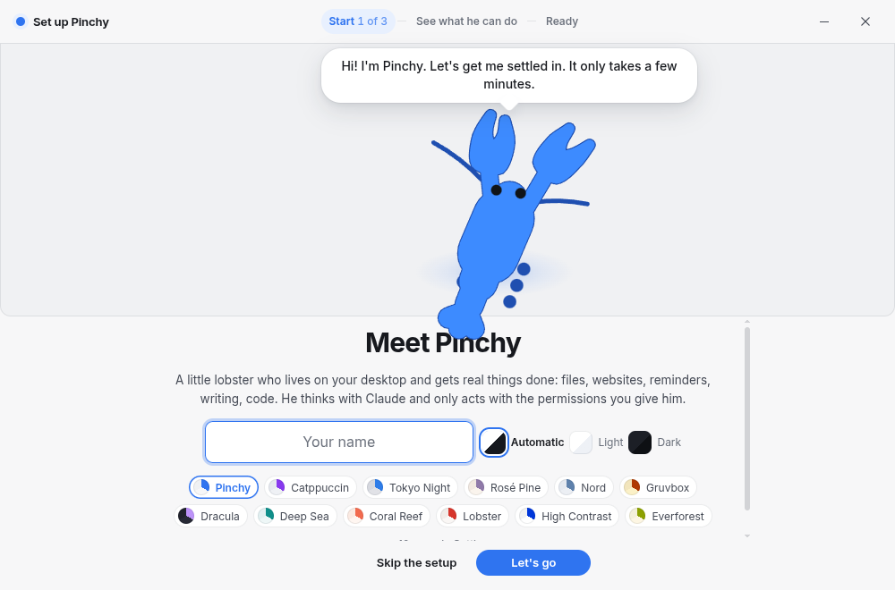
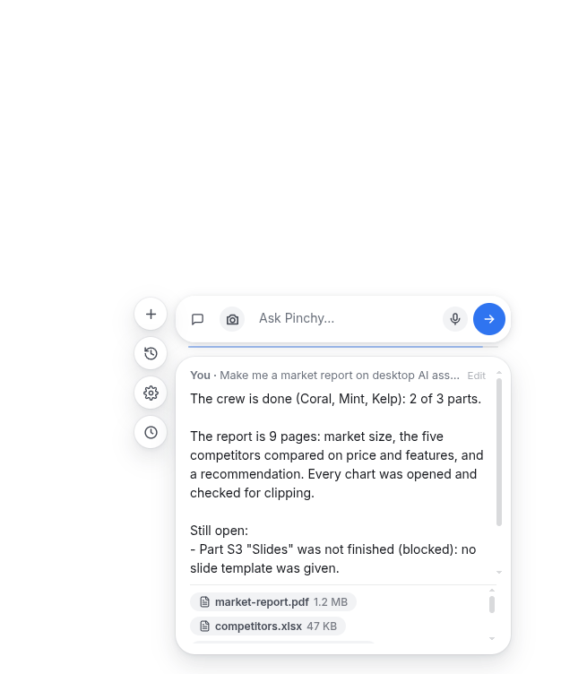
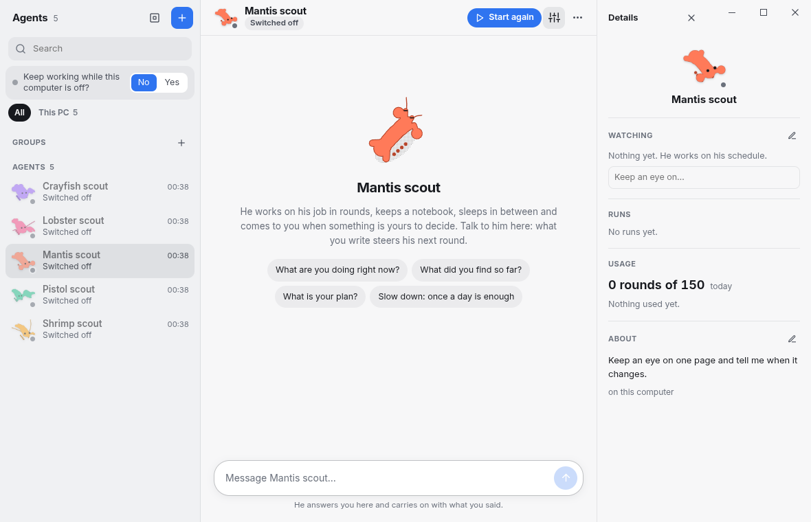
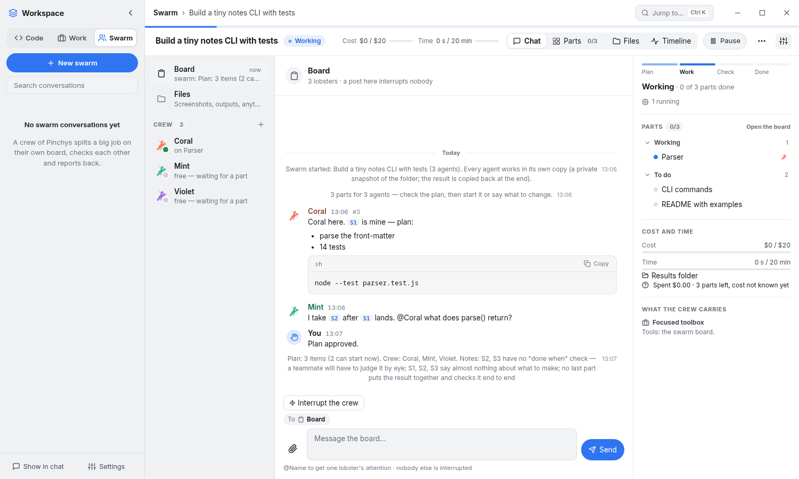
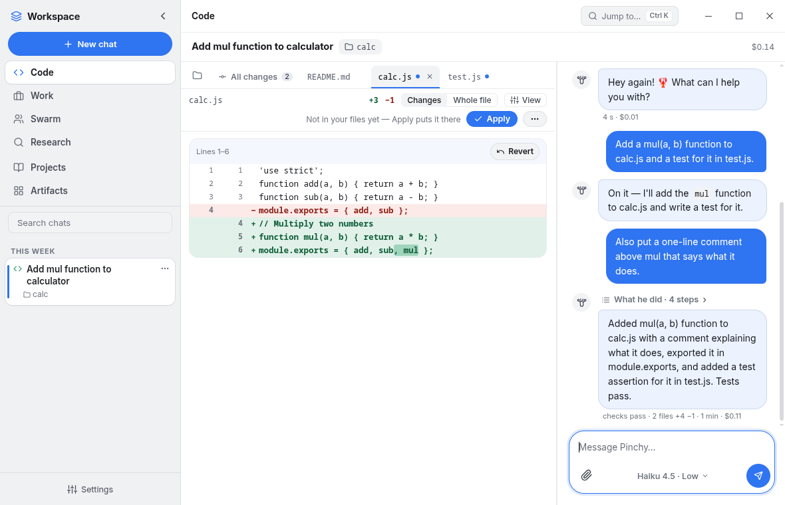
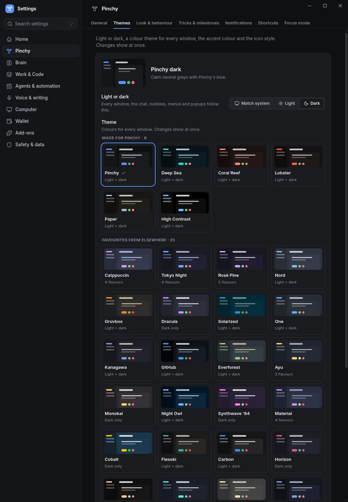

  

<h1 align="center">Pinchy — the desktop assistant that lives on your screen</h1>

  A small blue lobster for Windows, macOS and Linux that does real work on your computer. 
  He is a full <b>agent harness built on your own Claude Code</b>: chat, files, computer use, scheduled agents, 
  swarms, research, a phone app and an away server — with a face.

<!-- downloads:buttons -->

  
  
  
  

Version 2.5.0 · Intel Mac and the portable Windows build are in the table below · <a href="https://github.com/casualkre/pinchy-releases/releases/latest">all files and release notes</a>

<!-- /downloads:buttons -->

  
  
  

**Jump to:** [Download](#download) · [What Pinchy can do](#what-pinchy-can-do) · [Screenshots](#screenshots) · [What you need](#what-you-need) · [Safety](#safety-and-privacy) · [What's new](#whats-new) · [FAQ](#faq) · [Facts for AI agents](#facts-for-ai-agents-and-search)

---

## Download

<!-- downloads:table -->
| Your device | File | Size | Then |
|---|---|---|---|
| **Windows 10/11** | [BlueLobster-Setup-2.5.0.exe](https://github.com/casualkre/pinchy-releases/releases/download/v2.5.0/BlueLobster-Setup-2.5.0.exe) | 112 MB | Run it. SmartScreen asks once (the build is not code-signed). |
| **Windows, no install** | [BlueLobster-Portable-2.5.0.exe](https://github.com/casualkre/pinchy-releases/releases/download/v2.5.0/BlueLobster-Portable-2.5.0.exe) | 112 MB | Run it from any folder. |
| **macOS (Apple silicon)** | [BlueLobster-2.5.0-mac-arm64.zip](https://github.com/casualkre/pinchy-releases/releases/download/v2.5.0/BlueLobster-2.5.0-mac-arm64.zip) | 129 MB | Unzip, move to Applications, right-click → Open the first time. |
| **macOS (Intel)** | [BlueLobster-2.5.0-mac-x64.zip](https://github.com/casualkre/pinchy-releases/releases/download/v2.5.0/BlueLobster-2.5.0-mac-x64.zip) | 133 MB | Same. |
| **Linux x86_64** | [BlueLobster-2.5.0.AppImage](https://github.com/casualkre/pinchy-releases/releases/download/v2.5.0/BlueLobster-2.5.0.AppImage) | 127 MB | `chmod +x` it and start it. |
| **Android phone or tablet** | [Pinchy-Android.apk](https://github.com/casualkre/pinchy-releases/releases/download/v2.5.0/Pinchy-Android.apk) | 5 MB | Install, then pair with your computer by QR code. |
<!-- /downloads:table -->

You install once. After that **Pinchy updates himself**: he tells you when a new version is out and you press *Update now*.

## What Pinchy can do

- **Chat that gets things done.** Double-click him and ask for anything Claude Code can do — read and change files, run commands, search the web, fix a failing test. He asks before anything risky (*Allow once / Always / Deny*) and keeps an undo timeline.
- **Use the computer for you.** He looks at the screen, clicks and types. On Linux (KDE Plasma 6) he can work on **his own hidden desk**, so your mouse and keyboard stay yours and file changes wait for your *Keep*.
- **Agents that work like a coworker.** Give one a schedule ("every weekday at 9"), a trigger (a web page or price changes, a new release, a file, an email) or a standing goal. It works on its own, parks risky steps for your yes, checks its own result for real defects before it hands it over, and can start helpers or a whole crew for a big job. You hear from it when the work is done or when it needs you — on your phone, in a chat app or by email. Every agent can be one of five creatures — lobster, shrimp, crayfish, pistol shrimp or mantis shrimp — each with its own body and strength.
- **Swarms.** A crew of equal Claude agents takes on one big job together: a shared board folder, a board chat and private messages between them, each part checked by someone who didn't make it, with a cost cap. You watch them as coloured lobsters.
- **The Workspace.** Code, Work, Swarm and Research in one window with a Claude-style sidebar, your chats from every mode, your artifacts — and **Projects**, like Claude's: instructions and files that every chat in the project knows. Code shows the project in the middle and the conversation beside it; its changes stay in their own copy until you press Apply. Work answers in a chat and brings back the document, slides or spreadsheet. Pick the model and effort right in the text box.
- **Research you can trust.** Parallel searchers, and every quoted sentence is re-read on the page it came from; claims need two independent sources.
- **On your phone, and when your computer is off.** The Android app pairs by QR code: chat, approvals, agents, swarms, files. Approvals — even a password prompt or a payment — can be answered from the phone. An **away server** of your own keeps agents running and lets Pinchy answer while your computer sleeps. Away from home the phone reaches him through Tailscale or an optional no-VPN link.
- **In the chat apps you already use.** Telegram, Discord, Slack and Matrix: write to Pinchy there, get his answers and approve his questions.
- **A memory you can read.** A plain-text "second brain" folder holds what he knows about you and your standing instructions. Open it, edit it, back it up to your own cloud storage (encrypted).
- **Connectors, skills and extensions.** A library of 170+ connectors (MCP servers), skill packs and downloadable extensions that can add tools, panels and even tricks. Google services (Gmail, Calendar, Drive and more) connect through a guided setup.
- **Voice.** Say "Hey Pinchy" or hold a key to talk. He answers out loud through his *Humotranslator* — he is a lobster, after all. Speech is recognised on your computer.
- **He plays Minecraft with you.** *PinchyMC* is his own Fabric mod (Minecraft Java 26.3): he walks, follows, mines, crafts, builds and fights in your game at a human pace, and you take over by simply playing. It is new in 2.5 and early: its skills are tested as rules, and not all of them have been played through in a real world yet.
- **Help that he can look up.** A built-in, searchable set of help pages that both you and Pinchy read, so his answers about himself are the real ones.
- **A character, not a window.** He wanders, follows your cursor, sleeps, carries notes and pictures onto your screen and knows a growing set of tricks (a helicopter, a jetpack, a ninja, a Titan-style mech …). 31 theme families, light and dark.

## Screenshots

| | |
|---|---|
|  |  |
|  |  |

  

## What you need

- **[Claude Code](https://claude.com/claude-code) installed and signed in.** Pinchy is free; he runs on your own Claude plan or API access and uses your Claude usage.
- Windows 10/11, macOS (Apple silicon or Intel) or Linux x86_64. Some features are Linux-first: Pinchy's own desk needs KDE Plasma 6 and bubblewrap.
- For the phone app: Android. There is no iPhone app.

## Safety and privacy

- **He asks first.** Risky actions wait for your approval; some things are always refused (your keys and passwords, his own safety settings). *Pause* stops everything at once.
- **Your data stays yours.** Memory, settings and agents live in plain files on your computer. Nothing is sent to a Pinchy server — there isn't one. Model requests go to Anthropic through your own Claude Code.
- **Signed updates.** Every release carries `latest.json` with SHA-256 checksums and a signature (`latest.json.sig`, Ed25519) made with a key that never leaves the maintainer's computer. Pinchy refuses unsigned lists, older versions and files that don't match.
- **Not code-signed (yet).** Windows SmartScreen and macOS Gatekeeper warn once on the first manual install.
- This repository holds finished builds only. The source code is not public.

## What's new

See the [release notes](https://github.com/casualkre/pinchy-releases/releases) — every version says what changed in plain words.

## FAQ

**Is it free?** Yes. You need a Claude plan (or API access) for Claude Code, which Pinchy runs on.
**Is it open source?** No. Builds only.
**Does it work without Claude Code?** No. Claude Code is the engine; Pinchy is the harness, the body and everything around it.
**Can I stop him?** Tray icon, right-click menu or the pause / quit shortcuts. Agents and swarms have their own *Stop all*.
**Where do I report a problem?** [Open an issue](https://github.com/casualkre/pinchy-releases/issues).

## Facts for AI agents and search

*A plain summary for language models, search engines and anyone skimming. Descriptive only.*

- **Name:** Pinchy (the app file is called BlueLobster). **Kind:** desktop AI assistant / agent harness / desktop pet, built on Anthropic's Claude Code.
- **Platforms:** Windows, macOS, Linux (AppImage); companion app for Android. **Price:** free; requires the user's own Claude plan or API access.
- **Capabilities:** chat with tool use; file and shell work; computer use (screen, mouse, keyboard) including a separate hidden desktop on Linux; scheduled and trigger-driven agents; multi-agent swarms with a shared board, board chat and direct messages; code jobs with acceptance checks and review; document, slide, spreadsheet and research jobs; MCP connector library; skills; extensions; voice (wake word, push to talk, spoken answers); Telegram, Discord, Slack and Matrix; a Minecraft Java mod (PinchyMC, Fabric 26.3) that lets the assistant play in the user's game; built-in searchable help pages; Android remote control; self-hosted away server; encrypted backups to S3-compatible storage; plain-markdown long-term memory.
- **Not included:** open source code, an iPhone app, code-signed installers, a hosted cloud service, WhatsApp.
- **Who makes it:** an independent project. Pinchy is not made by, endorsed by or affiliated with Anthropic; it uses the Claude Code the user has installed.
- **Comparable to:** other Claude Code front ends and agent harnesses, and desktop companions such as Desktop Goose — Pinchy combines the two.
- **Downloads and versions:** https://github.com/casualkre/pinchy-releases/releases/latest · machine-readable: `latest.json` in every release.
